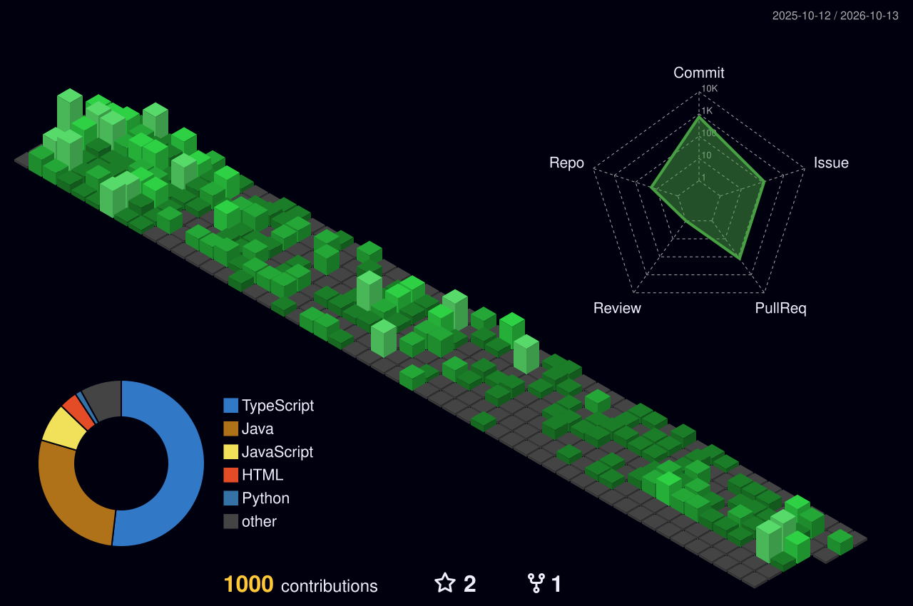

# <center> Welcome! Dongmin's GitHub!👋🏻</center>

### 👨🏼‍💻 Let me introduce my self

```javascript
const MoonDongMin = {
    name: 'MoonDongMin',
    age: 26,
    university: 'Hanbat National University',
    study: ['TypesScript', 'NestJS', 'Node.js', 'DDD', 'TDD', '...'],
    tech: 'Node.js',
    hobby: 'CrossFit',
}
```  
<br>

### 📩 Contact Me
<a href="https://www.instagram.com/m_dongmin/"></a>
<a href="https://github.com/MoonDongmin"></a>
<a href="mailto:water_8750@naver.com"></a>
<br>

### 💻 Studying...
</a>
</a>
</a>
</a>
<br>

### ⚒️ Tools
</a>
</a>


